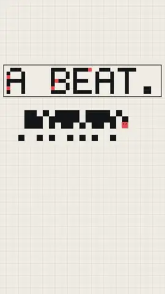
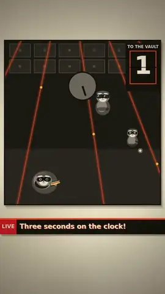

# motionex

Bare motion-graphics tools for AI agents, in one Docker service. An agent writes HTML scenes, Strudel songs and SFX recipes into a shared workspace, then calls tools over HTTP to voice, score, mix, render and check a finished video.

## Made with it: ON THE ONE

Five vertical music videos, each made end to end by one autonomous coding agent from a one-page brief: song, voice, sound effects, mix, picture and render. **[Watch them with sound →](https://payam-ranjbar.github.io/motionex/)**

<table>
<tr>
<td align="center"><a href="https://payam-ranjbar.github.io/motionex/#ep1"></a><br><b>Kickdrum Kaiju</b><br><sub>hard techno · 132 bpm</sub></td>
<td align="center"><a href="https://payam-ranjbar.github.io/motionex/#ep2"></a><br><b>One Pixel</b><br><sub>deep house · 122 bpm</sub></td>
<td align="center"><a href="https://payam-ranjbar.github.io/motionex/#ep3"></a><br><b>Heist on the Offbeat</b><br><sub>funk breakbeat · 110 bpm</sub></td>
<td align="center"><a href="https://payam-ranjbar.github.io/motionex/#ep4"></a><br><b>Run Loop</b><br><sub>driving techno · 128 bpm</sub></td>
<td align="center"><a href="https://payam-ranjbar.github.io/motionex/#ep5"></a><br><b>The Sun Swallower</b><br><sub>Persian techno · 124 bpm</sub></td>
</tr>
</table>

Five [pi](https://pi.dev) agents (DeepSeek V4.1 Flash) ran in parallel against one service: 20–62 minutes and under $1 of model time per episode. Their briefs, scenes, songs, SFX recipes, every job they submitted and their own production notes are in [`examples/on-the-one/`](examples/on-the-one/).

## Tools

| Area | Tools |
|---|---|
| Voice | `voice.speak` contract: `piper` (local TTS, raw IPA) or `elevenlabs` (acted, optional), one result shape; `voice.list`; `voice.phonemize`; `audio.process` (pitch, tempo, trim, tighten pauses, fx) |
| Picture | `picture.render` (any page with `window.__motion` → H.264, audio muxed in one encode), `picture.stills`, `image.contact-sheet` |
| Music | `music.render` (Strudel via the vendored Mucavex engine, section markers, seeded, polyphony 4096) |
| Sound | `sfx.synth` (DSP kit + recipes), `audio.mix` (exact-length track/bus mixer; neutral by default; presets) |
| Analysis | `audio.loudness`, `audio.levels`, `audio.speech-ratio`, `audio.stats`, `audio.silence`, `media.probe`, `media.frames` |
| Timing | `timeline.layout` (optional: voice-driven scenes, beat snapping, music markers, time specs) |
| Delivery | `media.encode` (presets: master, web-720p, fit-size, telegram-video, instagram-reel), `media.mux`, `media.concat`, `media.ffmpeg` (escape hatch) |

**Design rule: do not enforce.** Every tool is a primitive. Every opinion is a parameter or a named preset, and every default is neutral. Outputs are immutable and pinnable; deterministic tools are cached. New tools are folders with a manifest, written in any language, and can be mounted from outside the image. **One capability, several providers**: a contract such as `voice.speak` names the shared fields and result, and any tool can implement it (`{"tool": "voice.speak", "input": {"provider": "elevenlabs", ...}}`), so switching provider changes nothing downstream. See [`docs/providers.md`](docs/providers.md).

The skill that teaches agents how to use it lives in [`skill/motionex/`](skill/motionex/SKILL.md). The service also serves it at `/v1/skill`. What real productions taught us is in [`docs/retro-2026-11.md`](docs/retro-2026-11.md); known open issues are in [`docs/backlog.md`](docs/backlog.md).

## Run it
```bash
docker compose up --build -d                     # http://127.0.0.1:8095 (loopback only)
MX_WORKSPACE_HOST=/path/to/project docker compose up -d   # share a project folder with the service
curl -s http://127.0.0.1:8095/readyz
```
- **Workspace**: the host folder `./workspace` (or `MX_WORKSPACE_HOST`) is mounted at `/workspace`. Tool inputs are paths relative to it.
- **Listening room**: open http://127.0.0.1:8095/listen. It shows recent jobs with players, A/B (`?compare=ref,ref`), and live page previews.
- **Secrets** are files: copy `compose.local.example.yaml` to `compose.local.yaml` and put the ElevenLabs key in `secrets/elevenlabs_api_key`.
- **Samples**: Strudel sample banks download into the `motionex-cache` volume on first use (`offline: true` uses only the cache).

## Give an agent the skill
- **Claude Code**: `docker exec motionex mx skill install /tmp/s && docker cp motionex:/tmp/s/motionex ~/.claude/skills/`, or copy `skill/motionex` into `~/.claude/skills/`.
- **pi**: `pi --skill <repo>/skill/motionex`.
- **Anything else**: `GET /v1/skill/SKILL.md` and `GET /v1/skill/references/<file>`.

## Use it
```bash
cat > job.json <<'EOF'
{"tool": "voice.piper", "input": {"voice": "en_US-john-medium", "lines": [{"name": "hi", "text": "Hello there."}]}}
EOF
curl -s -X POST "http://127.0.0.1:8095/v1/jobs?wait=60" -H 'content-type: application/json' --data @job.json
docker exec motionex mx tools        # the same API through the CLI
```

## Develop
- Node 24, Python 3.12 (`uv venv .venv && uv pip install -r py/requirements.txt`), and Piper voices in `./voices`.
- `npm test` runs unit, tools, contract and integration tests on the host (ffmpeg from `ffmpeg-static`; Edge or Chromium through playwright-core).
- `node scripts/test.mjs docker` runs the opt-in Docker tests. `node scripts/test.mjs e2e` (with `MX_E2E_URL`) runs the acceptance film.
- `AGENTS.md` is the contract for coding agents: the tool manifest, handler and command protocol, shared modules, tests.

## Licence
[AGPL-3.0-or-later](LICENSE), because the image includes the AGPL Mucavex/Strudel renderer. See [`NOTICE.md`](NOTICE.md) for Piper (GPL), ffmpeg (GPL), Chromium, GSAP and the voices.
