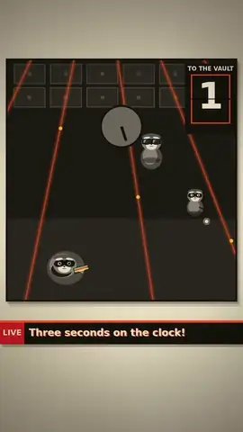

# Example: ON THE ONE, episodes 1–5

Five 25–28 second vertical (1080×1920) music videos, each made end to end by an autonomous coding agent with motionex.
Watch them with sound in the [gallery](https://payam-ranjbar.github.io/motionex/).

| | Episode | Music | Made by |
|---|---|---|---|
|  | [EP1 · Kickdrum Kaiju](ep1-kickdrum-kaiju/): a giant built out of speaker cones wakes the city, and its footsteps are the kick drum | hard techno, 132 bpm | one agent |
|  | [EP2 · One Pixel](ep2-one-pixel/): one lonely pixel finds a beat and becomes the eye of a whole picture | deep house, 122 bpm | one agent |
|  | [EP3 · Heist on the Offbeat](ep3-offbeat-heist/): three raccoon thieves crack a vault on the offbeat | funk breakbeat, 110 bpm | one agent |
|  | [EP4 · Run Loop](ep4-run-loop/): a runner stuck in a time loop breaks out into a groove | driving techno, 128 bpm | one agent |
|  | [EP5 · The Sun Swallower](ep5-sun-swallower/): a serpent swallows the sun, and a drummer drums it back up | Persian techno, 124 bpm | one agent |

## How they were made
- **The brief.** [`BIBLE.md`](BIBLE.md) holds the series rules every episode shares (hook in the first second, the beat is the
  editor, one build and one drop, words as visuals, an endcard). Each episode has a one-page `BRIEF.md`: a beat map, the
  look, the word effect, a music sketch and the SFX.
- **The agents.** Five [pi](https://pi.dev) coding agents ran in parallel against one motionex service, each with the
  instructions in [`AGENTS.md`](AGENTS.md) and the motionex skill (`skill/motionex/`). The model was DeepSeek V4.1 Flash;
  each episode took 20–62 minutes and cost $0.26–$0.74 in model time.
- **What each agent did**, all through motionex jobs:
  1. wrote the song in Strudel (`song.strudel`) and rendered it with `music.render` at an exact bpm;
  2. checked the drop with `audio.levels` per bar, and the clipping with `peak_db`;
  3. voiced its narration lines with `voice.piper`, then treated them with `audio.process`;
  4. wrote an SFX recipe (`sfx.mjs`) and synthesised it with `sfx.synth`;
  5. mixed everything with `audio.mix` to −14 LUFS and at most −1.5 dBTP true peak;
  6. wrote the picture as one seekable HTML page (`scene.html`, `window.__motion.seek(t)`);
  7. reviewed `picture.stills` and `image.contact-sheet` images before rendering;
  8. rendered with `picture.render` (audio muxed in the same encode);
  9. checked frames and loudness from the final MP4.
- **The record.** `notes.md` is each agent's own production log: its decisions, every job id, what it measured, what went
  wrong and what it would improve. `jobs/` holds every request it submitted, in the shape the API takes.

## Episode folder
| File | What it is |
|---|---|
| `BRIEF.md` | the one-page brief the agent got |
| `scene.html` | the whole picture: one canvas or DOM page, every frame a pure function of `t` |
| `song.strudel` | the score, rendered by `music.render` |
| `sfx.mjs` or `sfx/*.mjs` | the SFX recipe for `sfx.synth` |
| `jobs/*.json` | the job requests (`{"tool": ..., "input": ...}`) |
| `notes.md` | the agent's production notes |
| `caption.txt` | the post caption |

## Run one yourself
The paths inside the jobs assume the original workspace layout, `episodes/<id>/...`.
1. Start motionex with a workspace folder: `MX_WORKSPACE_HOST=/path/to/ws docker compose up -d`.
2. Copy an episode folder to `/path/to/ws/episodes/<id>/`.
3. Submit its jobs in production order: music, voice, voice processing, SFX, mix, stills, render:
   `curl -s -X POST "http://127.0.0.1:8095/v1/jobs?wait=300" -H 'content-type: application/json' --data @jobs/music.json`
4. Later jobs refer to earlier results as `job:<id>/<file>`. Those ids are from the original run, so replace them with
   the ids your own jobs return.

Or preview a scene without rendering: open `http://127.0.0.1:8095/listen` and load the page, or run `picture.stills` with a
few `times`.
